<div align="center">



<a href="https://github.com/RajdipDhar2007/Rack_Up-Onchain_Hi-Lo">
  
</a>

<br/>


-0052FF)


### 🎱 A mobile-first, multiplayer Hi-Lo pool-ball game on Base Sepolia.

**Guess whether the next ball is higher or lower. Wrong guess and you're out.**
**Last ones standing split the pot.**

<sub>It's like rock-paper-scissors, except the referee is a decentralized oracle network and nobody can bribe it.</sub>

<br/>

<p>
  <a href="#quick-start-play-locally"></a>
  <a href="#how-the-game-works"></a>
  <a href="https://github.com/RajdipDhar2007/Rack_Up-Onchain_Hi-Lo"></a>
</p>

<sub>⭐ A star takes 1 second, costs 0 gas, and makes a solo dev's whole week. ⭐</sub>

</div>

<div align="center"></div>

> ⚠️ **Testnet only.** This project targets Base Sepolia and local Anvil. Do not use real funds, and do not deploy to mainnet without an independent audit. See [Security](#security).

---

## Table of contents

- [See it in action](#-see-it-in-action)
- [How the game works](#how-the-game-works)
- [Features](#features)
- [Tech stack](#tech-stack)
- [Quick start: play locally](#quick-start-play-locally)
- [Playing with friends on the same Wi-Fi](#playing-with-friends-on-the-same-wi-fi)
- [Development](#development)
- [Deploying to Base Sepolia](#deploying-to-base-sepolia)
- [Project structure](#project-structure)
- [Game lifecycle and rules](#game-lifecycle-and-rules)
- [Security](#security)
- [Troubleshooting](#troubleshooting)
- [License](#license)
- [Show some love](#-show-some-love)

<div align="center"></div>

## 🎬 See it in action

<div align="center">



<sub>One full round, looped forever. Yes, you can stare at it. We won't judge.</sub>

</div>

<!--
  Want a real gameplay video? Record a round, then drag the .mp4 into this file while
  editing it on github.com. GitHub uploads it and inserts a playable video link here.
-->

## 🤔 Why you'll get hooked

> "Just one more round." - every player, 3 hours ago

| Feeling | Reason |
| --- | --- |
| 😰 **Instant tension** | 60 seconds on the clock. Higher? Lower? Your thumb hovers. |
| 🎲 **Zero trust needed** | Chainlink VRF picks the balls. Not the host, not us, not your cousin. |
| 🏆 **Real stakes, fake money** | Testnet ETH means all the bragging rights and none of the rent-money regret. |
| 📱 **Phone-friendly** | Your friends join from their couch in about 20 seconds. |
| 🔥 **Elimination drama** | Wrong guess? You're out. Spectating has never felt so personal. |

<details>
<summary><b>😂 Hall of fame: things players have definitely said</b></summary>

- "It was 8. EIGHT. There was a 50% chance. I regret everything."
- "I picked Lower because I had a feeling." (The feeling was wrong.)
- "The ball is rigged." (It is provably not. That is the whole point.)
- "Okay but what if I skip this round?" (Skipping gets you eliminated too. Nice try.)
- "Why is my heart rate 140 in a game with no real money?"

</details>

---

## How the game works

1. Players sign in, get a wallet, claim free starter test ETH (gas-free), pick a display name and join the lobby.
2. The host (admin) starts a game. A pool ball numbered **1–15** is drawn using verifiable randomness.
3. Within **60 seconds**, every player bets whether the **next** ball will be **Higher** or **Lower**.
4. The next ball is drawn. Wrong or skipped bets are **eliminated**; winners split both pools proportionally.
5. Repeat until the host ends the game.

## Features

| | |
| --- | --- |
| 📱 **Mobile-first player UI**<br/>plus a desktop admin console at `/admin` | 🔐 **Privy login**<br/>Google, email, SMS or wallet, or a no-account local wallet mode |
| ⛽ **Gasless faucet**<br/>relayed server-side, guarded by a 5-minute SIWE challenge | 🎲 **Provably fair**<br/>Chainlink VRF v2.5. The owner can't pick results or touch the pot |
| 👥 **No player cap**<br/>one bet per wallet per round, pari-mutuel payouts, batched claims | 🛟 **Safety valves**<br/>force-roll after 5 min, refunds after 1 hour |
| ✅ **Well tested**<br/>Vitest, Playwright, Foundry unit and invariant tests, CI | 🧱 **Open source**<br/>MIT licensed, hack away |

## Tech stack

| Layer     | Technology                                                       |
| --------- | ---------------------------------------------------------------- |
| Frontend  | Next.js 16 (App Router, Turbopack), React 19, TypeScript         |
| Web3      | wagmi, viem, TanStack Query, Privy                               |
| Contracts | Solidity, Foundry, OpenZeppelin, Solady                          |
| Oracle    | Chainlink VRF v2.5 (mock coordinator for local play)             |
| Testing   | Vitest, Testing Library, Playwright, Forge (unit and invariant)  |

---

## Quick start: play locally

No Privy account, no testnet funds and no deployment needed.

**Requirements:** Node 22+, npm 10+, [Foundry](https://book.getfoundry.sh/getting-started/installation) (on your `PATH`, or in the folder named by `FOUNDRY_BIN`).

```bash
git clone https://github.com/RajdipDhar2007/Rack_Up-Onchain_Hi-Lo.git
cd Rack_Up-Onchain_Hi-Lo
npm install
cd contracts
forge install --no-git foundry-rs/forge-std@v1.9.7 OpenZeppelin/openzeppelin-contracts@v5.4.0 Vectorized/solady@v0.1.26
cd ..
npm run local
```

`npm run local` starts everything in one command:

- an **Anvil** local chain
- the game, faucet and a **mock VRF coordinator** contracts
- a **keeper** that fulfils randomness requests
- the **Next.js** app on port 3000

When it is ready you'll see:

```
Admin (this computer):  http://localhost:3000/admin
Players (same Wi-Fi):    http://<your-lan-ip>:3000
```

Open `/admin` on the host computer to run the game (it signs in as the Anvil admin automatically). Each player opens the player address and taps **Sign in / create wallet**. Every device gets its own wallet.

> Each run of `npm run local` starts a fresh chain, so state does not persist between runs.

## Playing with friends on the same Wi-Fi

Players on other phones and laptops open `http://<host-lan-ip>:3000`. If they can't connect:

1. **Open the port (Windows).** Run once in an **Administrator** terminal:
   ```powershell
   npm run local:firewall
   ```
   Windows often labels home Wi-Fi as *Public*, which blocks incoming connections. You can also switch the network profile to *Private*.
2. **Same network.** Devices must be on the same Wi-Fi and SSID, not mobile data or a guest network.
3. **Router isolation.** Turn off *AP/client isolation* in your router settings if it's enabled.
4. **Use the current IP.** Your LAN IP can change; check `ipconfig` (Windows) or `ifconfig` / `ip a`.

The dev server accepts requests from private LAN ranges (`192.168.*.*`, `10.*.*.*`, `172.*.*.*`, `*.local`) via `allowedDevOrigins` in `next.config.ts`.

---

## Development

```bash
cp .env.example .env.local   # then fill in values (see below)
npm install
npm run dev                  # UI only; chain actions are disabled until contract addresses are set
```

> For a working game, use `npm run local`, or point the env vars at deployed contracts. A bare `npm run dev` has no contracts to talk to.

### Scripts

| Command                 | What it does                                           |
| ----------------------- | ------------------------------------------------------ |
| `npm run local`         | Full local stack: Anvil + contracts + keeper + app     |
| `npm run local:firewall`| Open TCP 3000 in Windows Firewall (run as Admin)       |
| `npm run dev`           | Next.js dev server only                                |
| `npm run build` / `start` | Production build and server                          |
| `npm run lint`          | ESLint                                                 |
| `npm run typecheck`     | TypeScript (`tsc --noEmit`)                            |
| `npm test`              | Vitest unit tests                                      |
| `npm run test:e2e`      | Playwright end-to-end tests                            |
| `npm run e2e:local`     | E2E against the local stack                            |
| `npm run contracts:build` | `forge build --sizes`                                |
| `npm run contracts:test`  | `forge test`                                         |

Run the full check suite:

```bash
npm run lint && npm run typecheck && npm test && npm run build
cd contracts && forge test && forge build --sizes
```

### Environment variables

Copy `.env.example` to `.env.local`.

| Variable | Scope | Purpose |
| --- | --- | --- |
| `NEXT_PUBLIC_PRIVY_APP_ID` / `NEXT_PUBLIC_PRIVY_CLIENT_ID` | public | Privy app (leave empty to disable Privy login) |
| `NEXT_PUBLIC_APP_URL` | public | Public app origin |
| `NEXT_PUBLIC_GAME_ADDRESS` / `NEXT_PUBLIC_FAUCET_ADDRESS` | public | Deployed contract addresses |
| `NEXT_PUBLIC_BASE_SEPOLIA_RPC_URL` | public | Browser RPC endpoint |
| `BASE_SEPOLIA_RPC_URL` | **server** | Server RPC endpoint |
| `FAUCET_AUTH_SECRET` | **server secret** | Signs faucet challenges |
| `FAUCET_RELAYER_PRIVATE_KEY` | **server secret** | Testnet-only relayer key for gasless claims |
| `ADMIN_ADDRESS`, `RELAYER_ADDRESS`, `VRF_SUBSCRIPTION_ID` | deploy | Non-secret deployment inputs |

Never commit `.env.local` or real keys. Use your host's encrypted secret store.

---

## Deploying to Base Sepolia

1. **Privy.** Create an app, enable the login methods you want, allowlist your HTTPS origin, and set `NEXT_PUBLIC_PRIVY_APP_ID`, optional `NEXT_PUBLIC_PRIVY_CLIENT_ID`, and `NEXT_PUBLIC_APP_URL`. For the admin wallet, sign in once first and use that embedded wallet address as `ADMIN_ADDRESS`, or sign in with an existing admin wallet.
2. **VRF.** Create and fund a Chainlink VRF v2.5 subscription on Base Sepolia with test LINK.
3. **Keystore.** Import your deployer into Foundry's encrypted keystore (never store a key in `.env`):
   ```bash
   cast wallet import deployer --interactive
   ```
4. **Deploy:**
   ```bash
   export ADMIN_ADDRESS=0x...
   export RELAYER_ADDRESS=0x...
   export VRF_SUBSCRIPTION_ID=...
   cd contracts
   forge script script/DeployBaseSepolia.s.sol:DeployBaseSepolia \
     --rpc-url https://sepolia.base.org \
     --account deployer \
     --sender 0x... \
     --broadcast
   ```
   The script uses the official Base Sepolia VRF coordinator and key hash and registers the game as a subscription consumer. The deploying account must own the VRF subscription.
5. **Fund** the faucet contract and the relayer wallet with Base Sepolia ETH. The faucet defaults to `0.001 ETH` per wallet; the owner can change it.
6. **Configure** the deployed addresses in the web environment. Store `FAUCET_AUTH_SECRET` and `FAUCET_RELAYER_PRIVATE_KEY` in an encrypted secret manager.
7. **Verify** both contracts on BaseScan and play a live smoke game with the admin wallet and two mobile wallets.

To redeploy only the game and keep a funded faucet, use `script/DeployHiLoGameBaseSepolia.s.sol:DeployHiLoGameBaseSepolia`.

---

## Project structure

```
.
├── src/
│   ├── app/              # Next.js routes: / (player), /admin, /api/faucet, /api/rpc
│   ├── components/       # GameRoom, AdminConsole, PoolBall, Countdown, ...
│   ├── hooks/            # use-game, Privy auth
│   └── lib/              # chain config, wagmi, local wallet, faucet auth/relayer
├── contracts/
│   ├── src/              # HiLoGame, BaseSepoliaFaucet, VRF interfaces and mocks
│   ├── test/             # Forge unit and invariant tests
│   └── script/           # Deployment scripts
├── scripts/              # local-dev (one-command stack), firewall helper, local e2e
├── e2e/                  # Playwright tests
└── .github/workflows/    # CI
```

More contract detail lives in [`contracts/README.md`](contracts/README.md).

## Game lifecycle and rules

```
Lobby → Initial VRF draw → Betting → Roll requested → Settled → Next round
```

- The opening ball is uniform over **1–15**. Later draws are uniform over the **other 14** balls, so ties are impossible.
- Winners divide **both pools** proportionally. If nobody picked the winning side, all bets are refundable.
- Players who bet wrong or skip a decisive round are **eliminated** from future bets. Refund rounds eliminate no one, and earlier winnings stay claimable.
- A joined player can **force the roll** after 5 minutes. A round can be **refunded** after a 1-hour oracle failure timeout.
- Only the owner can start or end games and open the next round. The owner cannot pick a result or withdraw the game pot.
- Display names are 3–16 UTF-8 bytes.

## Security

- The faucet enforces **one claim per address**, not per person. Sybil resistance is out of scope.
- The server relayer can only call the faucet's restricted `claimFor`. Keep its balance small and rotate the key if exposed.
- The Anvil keys in `scripts/local-dev.mjs` are public development keys. **Never use them on a real network.**
- This code has **not been audited**. Before any mainnet or real-value use, get an independent audit, use multisig ownership, add monitoring, and review legal requirements.

## Troubleshooting

| Symptom | Fix |
| --- | --- |
| Pages load but the game doesn't work | You ran `npm run dev` without contracts. Use `npm run local`. |
| Other devices can't reach the site | See [Playing with friends on the same Wi-Fi](#playing-with-friends-on-the-same-wi-fi). |
| `anvil not found` / `forge not found` | Install Foundry and add it to `PATH`, or set `FOUNDRY_BIN`. |
| Chain actions disabled | Set `NEXT_PUBLIC_GAME_ADDRESS` and `NEXT_PUBLIC_FAUCET_ADDRESS`. |
| Port 3000 or 8545 in use | Stop the other process, then rerun `npm run local`. |

## License

Released under the [MIT License](LICENSE).

<div align="center"></div>

## ⭐ Show some love

<div align="center">

If this project made you say "ooh, one more round", please **[give it a star](https://github.com/RajdipDhar2007/Rack_Up-Onchain_Hi-Lo)**.

It's the only currency we accept (testnet ETH is worth nothing, and we checked).

**Higher or lower? Starred or... not yet starred?** 😏

*Built with 🎱 and too much caffeine by [RajdipDhar2007](https://github.com/RajdipDhar2007).*

</div>
